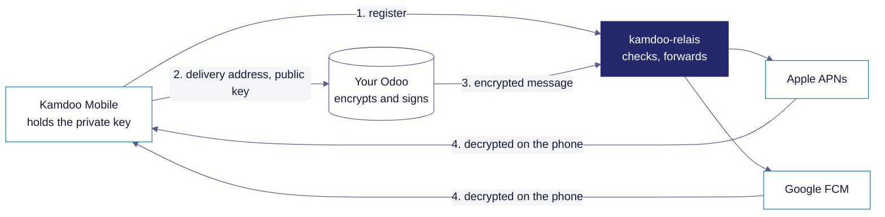

<p align="center">
  <picture>
    <source media="(prefers-color-scheme: dark)" srcset="docs/assets/readme/banniere-kamdoo-relais-sombre.svg">
    
  </picture>
</p>

**The relay that carries notifications from your company's Odoo to the Kamdoo Mobile app, through Apple (APNs) and
Google (FCM). It forwards messages that Odoo has already encrypted for one phone: it cannot read them, and it stores
nothing. One file, no dependencies: [`serveur.mjs`](serveur.mjs).**

## How it works



1. **The phone** creates a P-256 key pair for each company. It registers with the relay, which returns a delivery
   address, and gives your Odoo that address and its public key.
2. **Your Odoo** encrypts each notification for that phone (Web Push, RFC 8291: ECDH, HKDF-SHA-256, AES-128-GCM),
   signs the request (VAPID, RFC 8292) and posts it to the delivery address.
3. **The relay** checks the signature, then passes the encrypted message as it is to Apple or Google.
4. **The phone** decrypts it and shows it. On iPhone, Apple only sees a neutral text ("Kamdoo", "…") that the app's
   notification extension replaces; on Android, Google gets a data-only message. Both expire after one hour.

| Route | Called by | What it does |
| --- | --- | --- |
| `POST /v1/inscription` | the app | Returns a delivery address. The phone's Apple or Google token is **sealed** inside it (AES-256-GCM, key `RELAIS_SECRET`), with a fingerprint of the ERP's VAPID key and a 16-character label. Nothing is stored |
| `POST /v1/e/<sealed>` | Odoo | Opens the seal, refuses any request whose VAPID signature does not match the fingerprint (only the ERP the phone registered with can write to it), then forwards the encrypted message. Answers 410 when Apple or Google report an uninstalled app, so Odoo forgets the device |
| `GET /v1/f/<id>` | the app | A message too long for a notification: kept in memory, handed over **once**, then erased; erased after 10 minutes if nobody asks |
| `GET /sante` | monitoring | Whether each key is present and readable, never showing it |

## Get started

```bash
git clone https://github.com/kamka-ai/kamdoo-relais.git && cd kamdoo-relais
export RELAIS_SECRET=$(openssl rand -base64 32)
RELAIS_FAUX=1 RELAIS_ORIGINE=http://localhost:8080 node serveur.mjs
```

A local relay answers on port 8080 and prints notifications instead of sending them to Apple or Google;
`curl localhost:8080/sante` says which keys it has. In production, build the image and pass the configuration below:

```bash
docker build -t kamdoo-relais .
docker run -p 8080:8080 -e RELAIS_SECRET=... -e RELAIS_ORIGINE=https://push.example.com ... kamdoo-relais
```

| Variable | Secret | Purpose |
| --- | :-: | --- |
| `RELAIS_SECRET` | yes | 32 bytes, base64 (`openssl rand -base64 32`): seals the phone's token |
| `RELAIS_ORIGINE` | no | Public address of the relay, e.g. `https://push.example.com` |
| `RELAIS_ORIGINES_ANCIENNES` | no | Former public addresses, comma-separated, still accepted as VAPID audience so phones registered before a move keep receiving notifications |
| `APNS_CLE` | yes | Content of the Apple `.p8` key (Apple Push Notification service) |
| `APNS_CLE_ID` | no | ID of that key (10 characters) |
| `APNS_EQUIPE` | no | Apple team ID |
| `APNS_SUJET` | no | App bundle ID (default `com.kamkait.kamdoo`) |
| `FCM_COMPTE` | yes | JSON of a Firebase service account allowed to send messages |
| `RELAIS_FAUX` | no | `1` prints notifications instead of sending them (local test) |
| `PORT` | no | Listening port (default `8080`) |

Secrets go in your host's environment variables, never in the repository.

## Structure

| Path | What it holds |
| --- | --- |
| `serveur.mjs` | The whole relay: registration, sealing, VAPID check, APNs over HTTP/2, FCM v1, health |
| `Dockerfile` | Node 22 on Alpine, run as `node`, with a health check on `/sante` |
| `docs/assets/readme/` | The banners of this README |
| `LICENSE` | LGPL-3 |

## Supported versions

| Runtime or Odoo version | Branch | Status |
| --- | --- | --- |
| Node.js 22 (the image) | `main` | Supported |
| Odoo 14 to 16, with the free module [kamdoo_connect](https://github.com/kamka-ai/kamdoo-odoo) | `main` | Supported |
| Odoo 17 to 20, which do Web Push natively | `main` | Supported |

## Privacy and security

- **No database, no file.** Nothing about phones, messages or companies is written to disk.
- **The phone's token** lives sealed in the delivery address, which your Odoo keeps. The relay opens it for one
  delivery, then forgets it. **Long messages** stay at most 10 minutes in memory and are handed over once.
- **Caller IP addresses** are counted in memory to block abuse (too many requests per minute), erased within two
  minutes, never written.
- **Logs:** the startup line and, when Google refuses a delivery, the error code. Never an identifier, an address or
  any content. Run it behind a reverse proxy that does not log its requests; ours is Traefik with
  `traefik.http.routers.<router>.observability.accesslogs=false` on the relay's routers.
- **Nobody can read what passes through it**, not even Kamka IT: the decryption key never leaves the phone.
- Report a vulnerability privately through GitHub: the **Security** tab, then **Report a vulnerability**. Never in a
  public issue.

## Contributing

Open an issue first, then a pull request against `main`. The relay stays one file with no dependencies, and nothing it
does may write to disk or log a message's content.

## Learn more

| Document | Where |
| --- | --- |
| Kamdoo | [kamdoo.app](https://kamdoo.app) |
| The Odoo module for Kamdoo Mobile | [kamka-ai/kamdoo-odoo](https://github.com/kamka-ai/kamdoo-odoo) |
| Privacy policy | [kamdoo.app/privacy.html](https://kamdoo.app/privacy.html) · [en français](https://kamdoo.app/confidentialite.html) |
| Contact | [Kamka IT](https://kamka-it.com) · contact@kamka-it.com |

---

<sub>Kamdoo, by Kamka IT · compatible with Odoo, not affiliated with Odoo S.A. · LGPL-3</sub>
